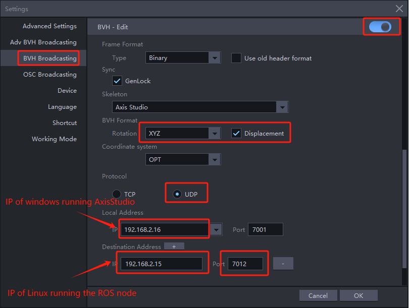

# Versions

If you need stable version of the project, please use code from latest tags

# Description

This repo is a project for teleoperation of Unitree G1 robot with noitom mocap system and Lerobot format dataset recording (both in simulation and real world).

# Dependencies and installation

### PC on Linux and Windows

You need 2 computers: a Windows PC to run Axis Studio and a Linux PC (Ubuntu 22.04 recommended) to run this whole repo. Running both on one PC with a virtual system should be possible, though it has not been tested.

### Ros2

Follow the guide to install:

https://docs.ros.org/en/humble/Installation.html

### Conda

Conda is necesarry as pinnochio with built-in casadi module can only be obtained throug conda-forge. Please install it

https://www.anaconda.com/docs/getting-started/miniconda/install/linux-install

Create conda env:

```
conda create python=3.10 pinocchio=3.1.0 numpy=1.26.4 -c conda-forge -n unitree_noitom_teleop
and activate
```


Install libraries from requirements.py through conda install -c conda_forge

### Unitree sdk2 py

Unitree_sdk2_py is required to run retargeting on the real robot:

First, install cyclone dds in your env:

```
cd ~
git clone https://github.com/eclipse-cyclonedds/cyclonedds -b releases/0.10.x 
cd cyclonedds && mkdir build install && cd build
cmake .. -DCMAKE_INSTALL_PREFIX=../install
cmake --build . --target install
```
Enter the unitree_sdk2_python directory, set CYCLONEDDS_HOME to the path of the cyclonedds you just compiled, and then install unitree_sdk2_python.

```
cd ~/unitree-g1-axis-studio-retarget/unitree_sdk2_python
export CYCLONEDDS_HOME=~/cyclonedds/install
pip3 install -e .
cd ..
```
If encounter any errors, check out official guide:

https://github.com/unitreerobotics/unitree_sdk2_python

### Mocap API:

API to receive data from axis studio (bvh stream):

```
cd MocapApi
pip install .
cd ..
```

### Teleimager:

To receive camera data from the robot via ZeroMQ, install teleimager (client version):

```
pip install teleimager
```

If encounter any errors, check out official guide:

https://github.com/unitreerobotics/teleimager

### Visualization

Visualization currently uses RVIZ. Refer to this repoo:

https://github.com/pnmocap/mocap_ros_urdf

# Axis Studio setup

### Axis Studio

Set up the correct parameters in Axis Studio settings to broadcast BVH (BVH - Edit to broadcast data from edit mode, BVH - Capturing to broadcast the current state of the costume)



# Robot setup

You need to install teleimager-server on robot to stream caneras from it. Please refer to official guide: 
https://github.com/unitreerobotics/teleimager

Make sure to install it with [all] flag to support all types of cameras

# How to run

- Always make sure rviz visualization is running. It will help notice any possible errors before sending any commands on actual robot

- Main program is src/main.py, which you can launch with different arguments.

### Visualization only

```
python src/main.py
```
Only starts retargeting and visualization. Will not send any commands on robot, and does not require robot to be connected to work

### Control the robot
```
python src/main.py --control-robot --network-interface <yourNetInterface>
```

<yourNetInterface> is the interface through which you are connected as listed in ``` ip a```.

This command will start retarget and will send commands on robot. When launching, robot won't move it's arms until 'e' is pressed. After that, it will wait 5 sec and slowly enable arms (move them into your curent state like in visualization). To return arms back to it's idle pose, press e again, which will slowly release the arms.

To close the program, press 'q'
Please don't interrupt the program when transition is happening or when it is shutting down.

Robot will slightly bend back to keep the balance as DFTP hands are too heavy for it.

### Record dataset
```
python src/main.py --control-robot --network-interface <yourNetInterface> --record-dataset --task-dir <WhereToRecord> --task-name <Name> --task-goal <GoalShortlyDescribed> --task-desc <taskDescription> --task-steps <1.DoThat 2. DO this etc>
```

This will allow for dataset recording (press 's' for start/stop demonstration recording). Requires installed, configured and running teleimager-server on the robot.

Will create folder ```task_name/``` in --task-dir (```./data/``` by default)

Records cameras, states and actions of arms, hands and torso in unitree format. Please refer to unitree_lerobor to edit, convert to Lerobot and train policies:

https://github.com/unitreerobotics/unitree_lerobot


### Other args:

- --frequency: control frequency of the robot (and retarget). 50 Hz is default and recommended for smooth teleop.

- --record-frequency: recording frequency of the dataset. Default is 50 Hz.

- --img-server-ip: teleimager-server ip. Robot's 192.168.123.164 is defult.

- --sim: swith interface to control simulated robot in isaac_sim. To be implemented soon.


## TODO:
- Implement --sim to control simulated robot
- Switch to unitree hand control method
- Fix hand dataset recording (currently ee states are just copies of actions)   